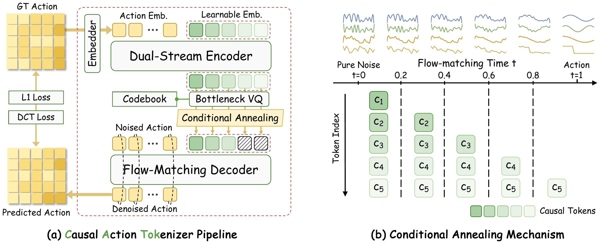

<h1 align="center">CATok: Rethinking Causal Action Tokenization with Conditional Annealing in Flow Matching</h1>

<p align="center">A causal action tokenizer that grounds discrete action tokens in the continuous flow-matching trajectory, providing a causally ordered, coarse-to-fine action representation for autoregressive VLA models.</p>

<p align="center">
<a href="https://chenyuzhangx.github.io/CATok/"></a>
<a href="https://arxiv.org/abs/2609.35469"></a>
<a href="LICENSE"></a>
<a href="requirements.txt"></a>
<a href="requirements.txt"></a>
</p>

---

## Overview

CATok is a diffusion-based action tokenizer for robot learning. It encodes robot action chunks into compact causal token sequences and reconstructs them with a flow-matching (MMDiT) decoder. A conditional annealing process assigns each token to a stage of the denoising trajectory, so the token sequence forms a coarse-to-fine, causally ordered action representation that plugs directly into autoregressive VLA training.

<p align="center">

</p>

*CATok architecture: a dual-stream encoder maps action chunks to latent queries discretized by a bottleneck VQ; a flow-matching decoder with conditional annealing reconstructs actions, masking the first κ(t) token embeddings according to flow timestep t.*

**Highlights**

- **Causal action tokenization**: a dual-stream encoder + VQ tokenizer turns action chunks into causally ordered token sequences.
- **Flow-matching decoder**: ODE-based action reconstruction with `euler` / `heun` solvers, plus single-step decoding.
- **Multi-dataset training**: weighted RLDS dataloaders (e.g. Bridge, LIBERO) with per-dataset action dimension and horizon handling.

## Installation
```Bash
git clone https://github.com/ChenyuZhangX/CausalActionTokenizer.git
cd CausalActionTokenizer
conda create -n catok python=3.10 -y
conda activate catok
pip install -r requirements.txt
pip install -e .
```

## Repository Structure

```bash
catok/                        # the CATok package
├── models/catok_ddt/         # dual-stream encoder, VQ, MMDiT flow-matching decoder
├── training/                 # RLDS dataloaders, action normalizers, batch transforms
└── utils/
conf/                         # hydra configs (one per benchmark)
├── config_libero_bridge/     # LIBERO + Bridge pretraining
└── config_robotwin/          # RoboTwin pretraining
scripts/
├── pretrain_multidataset.py  # LIBERO + Bridge pretraining entry
├── pretrain_robotwin.py      # RoboTwin pretraining entry
├── pretrain/                 # launchers (single / multi GPU)
├── finetune/                 # one-step decoder finetuning
└── evaluation/               # reconstruction metrics & visualization
```

## Training and Evaluation
### Pretraining (LIBERO + Bridge):
```Bash
sh <script_path> [mode] [gpu_id] [config_name] [config_path]

# examples:
# single gpu pretraining
sh scripts/pretrain/pretrain_multidataset.sh single 0
# multi gpus pretraining
# (train on 4 gpus with conf/config_libero_bridge/vanilla_diffusion.yaml)
sh scripts/pretrain/pretrain_multidataset.sh multi 0,1,2,3
```
+ `mode` (Optional): Training strategy. Use `single` for one GPU or `multi` for distributed training.

+ `gpu_id` (Optional): The index of GPUs to use (e.g., `0` or `0,1,2,3`).

+ `config_name` (Optional): The filename of your config in `config_path`. Defaults to `vanilla_diffusion`.

+ `config_path` (Optional): The directory of your config. Defaults to `../conf/config_libero_bridge`.

### Pretraining (RoboTwin):

Uses `conf/config_robotwin/vanilla_diffusion.yaml` (RoboTwin Franka data in RLDS layout, 16-dim actions):

```Bash
sh scripts/pretrain/pretrain_robotwin.sh single 0
sh scripts/pretrain/pretrain_robotwin.sh multi 0,1,2,3
```

### Finetuning (one-step decoder):
```Bash
# single GPU
torchrun --nproc_per_node=1 \
  scripts/finetune/finetune_multidataset_onestep.py \
  --ckpt /path/to/your/checkpoint.pth \
  --use_ddp \
  --epochs 800 \
  --lr 1e-4

# multi GPU
torchrun --nproc_per_node=4 \
  scripts/finetune/finetune_multidataset_onestep.py \
  --ckpt /path/to/your/checkpoint.pth \
  --use_ddp \
  --epochs 800 \
  --lr 1e-4
```

### Evaluation:

```Bash
# multi dataset (all datasets in config)
python scripts/evaluation/multidatasets/evaluation_vanilla_diffusion.py -m ckpt/best.pth
python scripts/evaluation/multidatasets/evaluation_vanilla_diffusion.py -m ckpt/best.pth --one_step

# per-dataset evaluation (evaluate each dataset individually, output summary table)
python scripts/evaluation/multidatasets/evaluation_vanilla_diffusion.py -m ckpt/best.pth --per_dataset

# single dataset evaluation (evaluate only the specified dataset)
python scripts/evaluation/multidatasets/evaluation_vanilla_diffusion.py -m ckpt/best.pth --dataset bridge

# single dataset (Libero only, legacy script)
python scripts/evaluation/libero/evaluation_vanilla_diffusion.py -m ckpt/best.pth
```
+ `model_path`: Path to your model checkpoint (e.g., best.pth).

+ `steps` (Optional): Number of sampling steps for the ODE solver. Default to `20`.

+ `one_step` (Optional): Decode with a single step instead of ODE sampling.

+ `per_dataset` (Optional): Evaluate each dataset individually and report per-dataset metrics with a summary table. Results are saved to `eval_*_per_dataset.json`.

+ `dataset` (Optional): Evaluate only the specified dataset by name (e.g., `bridge`). Implies `--per_dataset`.

## Dataset Structure

Datasets follow the RLDS layout below, with a `stats.json` (action normalization statistics) next to each dataset version directory. The `rlds_state_action_cache.pkl` is created automatically on first load.

```bash
# eg1
bridge
|-- 1.0.0
|-- rlds_state_action_cache.pkl # if none will be saved after first load
|-- stats.json # stats of action(delta eef)
# eg2
Libero_RLDS
|-- libero_10_no_noops
    |-- 1.0.0
    |-- rlds_state_action_cache.pkl # if none will be saved after first load
    |-- stats.json # stats of action(delta eef)
|-- libero_goal_no_noops
    |-- 1.0.0
    |-- rlds_state_action_cache.pkl # if none will be saved after first load
    |-- stats.json # stats of action(delta eef)
|-- libero_spatial_no_noops
    |-- 1.0.0
    |-- rlds_state_action_cache.pkl # if none will be saved after first load
    |-- stats.json # stats of action(delta eef)
|-- libero_object_no_noops
    |-- 1.0.0
    |-- rlds_state_action_cache.pkl # if none will be saved after first load
    |-- stats.json # stats of action(delta eef)
```

## Citation

If you find CATok useful in your research, please consider citing:

```bibtex
@article{zhang2026catok,
  title   = {Rethinking Causal Action Tokenization with Conditional Annealing in Flow Matching},
  author  = {Zhang, Chenyu and Cao, Yuhang and Du, Daru and Lu, Yingxi and Shao, Jing and Chen, Ruoqu and Liu, Jiajun and Cao, Liu and Liu, Yicheng and Zhao, Hang and Xu, Mengdi},
  journal = {arXiv preprint arXiv:2609.35469},
  year    = {2026}
}
```

## License

The code in this repository is licensed under the [Apache License 2.0](LICENSE), except for the third-party components listed in [NOTICE](NOTICE). In particular, `catok/models/catok_ddt/models.py` is adapted from [DiT](https://github.com/facebookresearch/DiT) and remains under the [CC-BY-NC 4.0](LICENSES/LICENSE.CC-BY-NC-4.0) license (**non-commercial use only**); the original copyright notices are retained in the source file headers.
